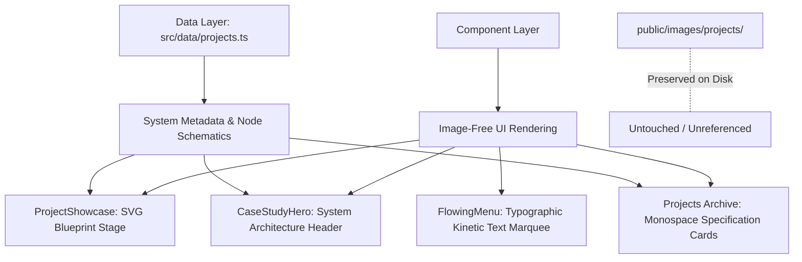

# Engineering Atlas — Design Specification & Image-Free Creative Direction

**Document Version:** 1.0.0  
**Status:** Approved Architecture Draft  
**Role:** Principal Design Engineer  
**Repository:** [https://github.com/aryan-amdavadi/Portfolio](https://github.com/aryan-amdavadi/Portfolio)  

---

## 1. Executive Summary & Creative Manifesto

The portfolio experience is transitioning from a traditional imagery-dependent showcase to an **Engineering Atlas**—an original, technical publication aesthetic that communicates software engineering capability through:

1. **System Maps & Architectural Topologies** rather than static raster screenshots or generic photos.
2. **Editorial Typography & High-Contrast Hierarchy** rather than template card boxes.
3. **Data-Dense Schematics & Interactive Models** generated dynamically via semantic HTML, CSS surfaces, and inline vector mathematics.
4. **Strict Image-Free Rendering:** Zero raster images (``, `next/image`, background CSS images, remote asset URLs, or image-based previews) in the active UI. Existing asset files in `public/images/projects/` remain completely untouched on disk as archival substrate, but are never requested or rendered by the client runtime.

### The Concept: Engineering Atlas
An atlas is not a gallery of photographs; it is an authoritative, precision-drafted cartography of complex terrain. In this portfolio, every software project is treated as an engineered territory with distinct constraints, data topologies, state machines, and protocols. The visual presentation evokes an independent research studio or advanced systems journal: disciplined hairline rules, coordinates, technical registration marks, monospace telemetry, and tactile SVG systems diagrams.

---

## 2. Verified Current-State Findings

A comprehensive audit of the active working tree (`main` at `d2ac738`) reveals the following structural, visual, and performance baseline:

### 2.1 Component Architecture & Routing
- **Homepage (`src/app/page.tsx`)**:
  - Contains sections: Hero (`.hero-section`), Builder (`#builder`), Problem & System (`#problem-system`), The Work (`#work`), Thinking / Process (`#thinking`), and Connect (`#connect`).
  - `#work` hosts `<ProjectShowcase />` within `.section-content`.
- **Showcase Component (`src/components/projects/ProjectShowcase.tsx` & `.css`)**:
  - Implements a 2-column layout (Artwork Left ~58%, Information Right ~42%) with a horizontal numbered tablist navigator (`.editorial-navigator`) below.
  - Relies heavily on a raster `<Image fill priority />` element inside `.artwork-image-container` framed with a dark linear gradient vignette.
- **Projects Archive (`src/app/projects/page.tsx`)**:
  - Renders an archive grid (`.archive-grid`) of 6 project cards, each loading `project.image` via `next/image` in a `16/10` aspect-ratio container.
- **Case Study Detail (`src/app/projects/[id]/page.tsx`)**:
  - Structured into a 9-part editorial narrative.
  - The hero component (`CaseStudyHero.tsx`) embeds a large `16/9` `next/image` banner with gradient overlays and corner brackets.
- **Navigation & Drawer Menu (`src/components/layout/Navigation.tsx` & `FlowingMenu.tsx`)**:
  - `Navigation.tsx` defines `MENU_ITEMS` referencing 6 remote Unsplash URLs (`https://images.unsplash.com/...`).
  - `FlowingMenu.tsx` renders repeating marquee ribbons where each item contains `<div className="marquee__img" style={{ backgroundImage: `url(${image})` }} />`.
- **Background & 3D Engine (`GhostFibersBackground.tsx`, `SceneDirector.ts`)**:
  - `GhostFibersBackground` renders WebGL fiber lines via OGL canvas behind the DOM (`z-index: -10`).
  - `SceneDirector.ts` runs a Three.js canvas in the background with `ProjectArtifacts` (wireframe meshes).
  - Both layers have `pointer-events: none` and do not intercept DOM clicks.

---

## 3. Existing Visual & Image Entry Points (Inventory)

The audit mapped every single image rendering point across the active codebase:

| Location | Element Type | Source Reference | Problem / Impact |
| :--- | :--- | :--- | :--- |
| `src/components/projects/ProjectShowcase.tsx:100-108` | `<Image fill ... />` | `activeProject.image` (`/images/projects/*.webp`) | Raster crutch; creates visual dependency on mock artwork rather than demonstrating pure frontend engineering. |
| `src/components/projects/CaseStudyHero.tsx:57-65` | `<Image fill ... />` | `project.image` (`/images/projects/*.webp`) | Consumes top-of-fold vertical space on case study pages without conveying technical system architecture. |
| `src/app/projects/page.tsx:55-63` | `<Image fill ... />` | `project.image` (`/images/projects/*.webp`) | Standard card thumbnail grid; feels like a generic blog or portfolio template. |
| `src/components/layout/FlowingMenu.tsx:193` | CSS `backgroundImage` | `MENU_ITEMS[].image` (Unsplash remote URLs) | Initiates external HTTP network requests to Unsplash; jarring generic stock imagery inconsistent with an engineering portfolio. |
| `src/components/layout/Navigation.tsx:9-16` | Data Array | `https://images.unsplash.com/...` | Hardcoded remote image URLs embedded in navigation config. |
| `src/data/projects.ts` | Data Fields | `image: string`, `alt: string` | Stored metadata currently bound to raster files. |

**Image Preservation Constraint:**  
In accordance with user constraints, the files inside `public/images/projects/` (`enginexus.*`, `pulsesync.*`, `rapaport.*`, `secretspeak.*`, `splitsphere.*`, `tabster.*`) **must remain untouched**. They will not be deleted, renamed, overwritten, or modified on disk; the application code simply ceases to reference, import, or render them.

---

## 4. Layout & Visual Problems to be Removed

1. **Reliance on Photographic/Artwork Crutches:**  
   The current showcase assigns 58% of the stage to a static image container. If the image is disabled or slow, the layout collapses into an empty placeholder.
2. **Generic Card-Based Visual Rhythm:**  
   The card container pattern (rounded boxes with box-shadows) makes the site feel like a typical UI template rather than an intentional publication.
3. **External Network Leaks:**  
   `FlowingMenu` requesting remote Unsplash assets introduces network latency, potential CORS/privacy concerns, and aesthetic dissonance.
4. **Scale Imbalance in Showcase:**  
   Project title, problem statement, and technology stack are compressed into a 42% right-hand column, causing text cramping while 58% of the width is spent on passive imagery.
5. **Mobile Squishing:**  
   On mobile screens (< 768px), the artwork panel and info panel stack into a tall vertical block that requires excessive scrolling to reach actionable controls.

---

## 5. Proposed Project Showcase Composition: The Engineering Atlas

Instead of an image panel, the active showcase stage will become an **Interactive Blueprint Stage** flanked by an **Editorial Systems Dossier**.

```
+----------------------------------------------------------------------------------------------------+
| ATLAS INDEX // 01 OF 06                                                    SYSTEM STATUS: OPERATIONAL|
+----------------------------------------------------------------------------------------------------+
|                                                  |                                                 |
|  [ZONE A: ARCHITECTURAL SCHEMATIC STAGE]         |  [ZONE B: SYSTEMS DOSSIER]                      |
|  - Real-time SVG topology & data visualizer      |  - Monospace category & system classification   |
|  - Dynamic node connections & bus channels       |  - Editorial Display Title (Playfair / Serif)   |
|  - Live metric gauges / state indicators         |  - Problem Constraint Statement                 |
|  - Project-specific engineering signature:       |  - Architectural Solution Statement             |
|    * SplitSphere: DAG settlement flow            |  - Engineering Specifications (Stack Chips)     |
|    * Rapaport: 2D matrix coordinate crosshair    |  - Primary Action: [INSPECT CASE STUDY ->]      |
|    * SecretSpeak: Bijective glyph matrix         |  - Secondary Action: [SOURCE REPOSITORY ->]     |
|    * Tabster: Webhook order state machine        |                                                 |
|    * PulseSync: Dual-core RTOS telemetry osc.    |                                                 |
|    * EngiNexus: 15-model relational graph        |                                                 |
|                                                  |                                                 |
+----------------------------------------------------------------------------------------------------+
|  [ZONE C: NUMBERED ATLAS NAVIGATOR & SYSTEM INDEX]                                                 |
|  [01 SplitSphere]  [02 Rapaport]  [03 SecretSpeak]  [04 Tabster]  [05 PulseSync]  [06 EngiNexus]   |
+----------------------------------------------------------------------------------------------------+
```

### 5.1 Project-Specific Visual Signatures (Image-Free Schematics)

Each project will render a bespoke, live, mathematical SVG/CSS interface visual in Zone A:

1. **SplitSphere (Financial Graph Simplification)**:
   - An interactive directed debt graph visualizer.
   - Nodes represent participants ($A, B, C, D$); directed arcs indicate raw transactions with currency weights.
   - Interactive toggle displays the reduction into minimal settlement edges ($\le N - 1$).
   - Hairline balance vectors with real-time SVG arrowheads and numerical ledger counters.

2. **Rapaport Calculator (2D Pricing Matrix Pipeline)**:
   - A crystalline CAD grid with active coordinate reticles.
   - Horizontal axis: Color grades ($D \rightarrow M$); Vertical axis: Clarity tiers ($IF \rightarrow I3$).
   - Dynamic crosshairs that track cell coordinates, displaying real-time carat boundary valuations and formula multipliers ($Carat \times Rate \times Discount$).

3. **SecretSpeak (Deterministic Procedural Language Studio)**:
   - A modular typographic glyph matrix.
   - Monospaced ASCII/Unicode character substitution lattice illustrating deterministic tokenization.
   - Visual comparison showing the plain-text token stream transforming into structured symbolic blocks without entropy loss.

4. **Tabster (Commerce Order State Machine)**:
   - A finite state machine flowchart rendered in precision SVG.
   - Nodes: `CART_LOCK` $\rightarrow$ `PAYMENT_INTENT` $\rightarrow$ `WEBHOOK_HMAC` $\rightarrow$ `ORDER_FULFILLED`.
   - Active pulsing data packet moving along bus lines to represent Stripe webhook event reconciliation and database transaction commits.

5. **PulseSync (Dual-Core Embedded Telemetry)**:
   - A dual-lane digital oscilloscope trace.
   - Upper lane: Core 0 interrupt ADC pulse train (250 Hz continuous interrupt line).
   - Lower lane: Core 1 filtered cardiac waveform (simulated rolling ECG QRS complex via SVG spline) with noise-rejection band boundaries.

6. **EngiNexus (15-Model Academic Relational Core)**:
   - An architectural entity-relationship constellation.
   - Interconnected relational hubs (`Students`, `Projects`, `Equipment`, `Labs`) connected by dashed foreign-key links and composite junction nodes.

---

## 6. Proposed Color Palettes (Dark & Light Foundations)

The color system builds upon the project's existing identity while refining contrast, reducing mud, and ensuring absolute WCAG AA / AAA compliance.

### 6.1 Dark Theme: Midnight Blueprint (`[data-theme="dark"]`)
*Inspiration: Precision CAD drafting screen, deep midnight oceanic substrate.*

| Semantic Token | Hex / HSL | Role & Usage |
| :--- | :--- | :--- |
| `--bg-base` | `#161F2E` | Deep drafting canvas; subtle blue-black substrate. |
| `--bg-surface` | `#1D2A3D` | Primary card / schematic panel background. |
| `--bg-surface-elevated` | `#25364E` | Hovered nodes, active controls, inspector wells. |
| `--text-primary` | `#F8FAFC` | Main headings, title typography, key values (Contrast: 14.2:1). |
| `--text-secondary` | `#94A3B8` | Body copy, technical descriptions (Contrast: 7.1:1). |
| `--text-muted` | `#64748B` | Section indexes, grid numbers, metadata labels (Contrast: 4.6:1). |
| `--border-subtle` | `rgba(255, 255, 255, 0.08)` | Grid rules, schematic divisions. |
| `--border-strong` | `rgba(255, 255, 255, 0.22)` | Active panel perimeters, interactive node borders. |
| `--border-focus` | `#00A896` | Accessible focus-visible indicator ring. |

### 6.2 Light Theme: Technical Parchment (`[data-theme="light"]`)
*Inspiration: Archival linen paper, sumi ink, vintage engineering patent diagrams.*

| Semantic Token | Hex / HSL | Role & Usage |
| :--- | :--- | :--- |
| `--bg-base` | `#FBF9F1` | Warm unbleached drafting paper foundation. |
| `--bg-surface` | `#F3EFE0` | Schematic panel ground, card surfaces. |
| `--bg-surface-elevated` | `#E8E2CD` | Elevated interactive controls, button wells. |
| `--text-primary` | `#1A2412` | Deep sumi-ink typography, main titles (Contrast: 13.8:1). |
| `--text-secondary` | `#455230` | Technical body copy, legible olive-charcoal (Contrast: 7.2:1). |
| `--text-muted` | `#6B7853` | Metadata stamps, secondary labels (Contrast: 4.8:1). |
| `--border-subtle` | `rgba(26, 36, 18, 0.10)` | Hairline drafting grid lines. |
| `--border-strong` | `rgba(26, 36, 18, 0.26)` | Panel perimeters and active borders. |
| `--border-focus` | `#065A60` | Accessible focus ring in high-contrast teal. |

### 6.3 Project Accent Tokens (Accessible Dark/Light Pairs)

| Project | Dark Accent (`--project-accent`) | Light Accent (`--project-accent-light`) | Engineering Domain |
| :--- | :--- | :--- | :--- |
| **SplitSphere** | `#00D2B4` (Teal) | `#006466` (Deep Teal) | Graph Optimization / Balance Settlement |
| **Rapaport** | `#56CFE1` (Cyan) | `#1D6996` (Slate Blue) | 2D Valuation / Matrix Lookup |
| **SecretSpeak** | `#C084FC` (Amethyst) | `#6B21A8` (Deep Violet) | Procedural Symbolic Language |
| **Tabster** | `#FDBA74` (Warm Ochre) | `#B45309` (Burnished Amber) | Transactional Commerce State Machine |
| **PulseSync** | `#FB7185` (Coral Red) | `#BE123C` (Crimson) | Dual-Core Real-Time Biosignals |
| **EngiNexus** | `#4ADE80` (Emerald) | `#166534` (Deep Forest) | Academic Relational Knowledge Graph |

---

## 7. Typography, Spacing, Border & Motion Principles

### 7.1 Typography
- **Monospace (`--font-mono`: JetBrains Mono, Consolas)**:
  - Used for index tags, coordinate markers, schema labels, code snippets, status stamps.
  - Tracking: `0.1em` to `0.15em` (`uppercase`).
- **Editorial Serif (`--font-serif`: Playfair Display, Georgia)**:
  - Used for primary showcase titles (`.editorial-project-title`, `.cs-title`).
  - Fluid sizing: `clamp(2rem, 5vw, 3.5rem)`, leading: `1.1`.
- **Sans-Serif (`--font-sans`: Inter, system-ui)**:
  - Used for body prose, problem/solution descriptions, button labels.
  - Line length strictly capped at `65ch`–`68ch` with `line-height: 1.75` for effortless reading.

### 7.2 Hairline Rules & Alignment Grids
- Replace heavy card shadows with crisp hairline rules (`1px solid var(--border-subtle)`).
- Use technical corner crosshairs (`+`) and registration marks (`REC // 01`) at structural intersections.
- Asymmetrical alignment: align technical labels to the top baseline of corresponding diagrams.

### 7.3 Motion: Functional & Restrained
- **No decorative floating physics or bobbing shapes.**
- State changes (tab switching, inspector activation) execute via crisp transitions: `180ms–240ms cubic-bezier(0.16, 1, 0.3, 1)`.
- SVG schematics use minimal, predictable pulse indicators (e.g. data packets or dash arrays) with full reduced-motion overrides:
  ```css
  @media (prefers-reduced-motion: reduce) {
    *, *::before, *::after {
      animation: none !important;
      transition-duration: 0.01ms !important;
    }
  }
  ```

---

## 8. Image-Free Technical Architecture

### 8.1 Zero-Image Runtime Guarantee
1. **No `<Image>` imports:** Remove all `import Image from 'next/image'` across the project showcase, case study hero, and archive catalog.
2. **No `` tags or raster assets:** No JPEG, PNG, WebP, GIF, or AVIF requested by the DOM.
3. **No remote image fetches:** Remove all Unsplash image URLs from `MENU_ITEMS` in `Navigation.tsx`. `FlowingMenu` will render pure typographic kinetic text banners without background image thumbnails.
4. **Physical Asset Preservation:** All files in `public/images/projects/` remain untouched on disk to preserve repository integrity.

### 8.2 Replacement Implementation Strategy



---

## 9. Responsive Behavior Specifications

The image-free layouts are designed mobile-first with precise breakpoint adaptations:

### 9.1 Mobile Small (375px × 812px) & Mobile Large (430px × 932px)
- **Showcase Stage:** Stacks vertically. The SVG Blueprint Stage adopts a 4:3 compact aspect ratio (height: `240px–280px`).
- **Diagrams:** Render simplified, high-contrast schematic views with legible touch targets (minimum 44px).
- **Horizontal Overflow:** Strictly zero. All text blocks use `word-wrap: break-word` and flex containers wrap cleanly.
- **Navigator:** Displays a horizontal swipeable pill bar or segmented stepper (`01` through `06`).

### 9.2 Tablet (768px × 1024px)
- **Showcase Stage:** 2-column layout begins at `768px`. Stage allocates 50% width to the schematic and 50% to the project dossier.
- **Archive Catalog:** Transitions from single-column to a 2-column engineering specification grid.

### 9.3 Desktop (1024px, 1440px, 1920px)
- **Showcase Stage:** 58% width allocated to the high-density SVG Blueprint Stage and 42% to the editorial dossier.
- **Interactive Inspector:** Full hover and click exploration with sub-millisecond updates and zero layout shift.

---

## 10. Accessibility & Usability Standards

- **WCAG 2.1 AA Compliance:** Minimum 4.5:1 contrast for body copy; 3:1 for large display titles and technical UI borders.
- **Semantic Structure:** Single `<h1>` per page, sequential `<h2>` section headers, and semantic `<nav>`, `<article>`, `<main>` landmarks.
- **Keyboard Traversal:**
  - `Tab` / `Shift+Tab` navigates through project tabs and interactive schematic nodes.
  - `ArrowLeft` / `ArrowRight` cycles through projects in the showcase navigator.
  - `Escape` dismisses active node selection in interactive diagrams.
  - All interactive elements exhibit high-contrast `:focus-visible` rings (`outline: 2px solid var(--border-focus); outline-offset: 3px`).
- **Screen Reader Announcements:** All SVG diagrams include `role="img"`, accessible `aria-label` descriptions, and live regions (`aria-live="polite"`) for dynamic inspector updates.

---

## 11. Acceptance Criteria for Subsequent Implementation Phases

### Phase 2: Image-Free Project Showcase
- [ ] Replace raster `<Image>` in `ProjectShowcase.tsx` with project-specific SVG blueprint components for all 6 projects.
- [ ] Refactor `ProjectShowcase.css` to support the new blueprint stage with technical crosshairs, coordinate rules, and zero raster dependencies.
- [ ] Verify tab switching updates schematic visualizer instantaneously without lag.

### Phase 3: Image-Free Case Studies & Hero Refactor
- [ ] Refactor `CaseStudyHero.tsx` to eliminate `<Image>`, replacing it with a full-width system architecture banner and live status gauges.
- [ ] Ensure all 6 case studies at `/projects/[id]` render without a single image network request.
- [ ] Verify contextual previous/next case study navigation.

### Phase 4: Image-Free Archive & Navigation Cleanup
- [ ] Refactor `src/app/projects/page.tsx` to remove `<Image>` from all 6 catalog cards, replacing with technical specification schematics.
- [ ] Refactor `Navigation.tsx` and `FlowingMenu.tsx` to completely remove remote Unsplash URLs and background images.
- [ ] Ensure kinetic text marquees function smoothly using typography and SVG divider glyphs.

### Phase 5: Design Token & Visual Polish
- [ ] Update `tokens.css` with the refined Midnight Blueprint and Technical Parchment palettes.
- [ ] Calibrate light mode contrast across all technical callouts, diagrams, and controls.
- [ ] Ensure strict `@media (prefers-reduced-motion: reduce)` compliance.

### Phase 6: Final QA, Verification & Delivery
- [ ] Automated regression tests (`npm test`, `npm run lint`, `npm run build`, `npx tsc --noEmit`) pass with 0 errors.
- [ ] Network tab audit confirms 0 image asset requests on homepage, archive, and case studies.
- [ ] Commit and push with verified SHA.

---

## 12. Verification & Baseline Execution Plan

Before commencing Phase 2 implementation, baseline checks must be executed and recorded:
1. Run `npx tsc --noEmit` to verify TypeScript compiler health.
2. Run `npm run lint` to document current ESLint diagnostics.
3. Run `npm test` to verify route and data integrity.
4. Run `npm run build` to confirm static generation and bundle compilation.
5. Record results in the Phase 1 final delivery report.
