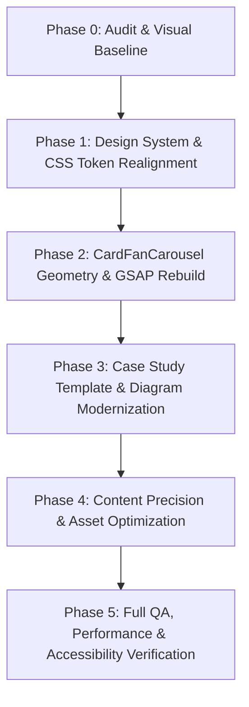

# Project Experience Audit & Visual Baseline

**Document Version:** 1.0.0  
**Phase:** Phase 0 — Visual Baseline & System Audit  
**Target Repository:** `https://github.com/aryan-amdavadi/Portfolio`  
**Lead:** Senior Frontend Engineer & Design Systems Architect  
**Date:** October 2026  

---

## 1. Executive Summary

This audit establishes the empirical root causes behind visual instability, layout distortion, missing content, and broken interactions across the **Project Showcase** (Card Fan Carousel) and **Project Detail** (`/projects/[id]`) case-study experiences.

The portfolio is built on **Next.js 16.3.5 (App Router, Turbopack)**, **React 19.2.8**, **GSAP 3.15**, and a bespoke **Vanilla CSS design token architecture** (`src/styles/tokens.css`, `layout.css`, `typography.css`, `case-study.css`). 

### Core Audit Verdict
The visual degradation is not caused by a single styling error, but by three cascading architectural regressions:
1. **Critical DOM Eradication via Text-Splitter Defect:** In `ScrollReveal.tsx`, non-string children passed to the component evaluate to an empty array (`[]`). Because `CaseStudyHero`, `CaseStudySection`, `TechnologyEvidence`, and `AlgorithmVisualizer` were wrapped in `<ScrollReveal>`, their entire JSX subtrees were discarded. The case-study pages appeared blank or incomplete because their core content was literally stripped from the rendered DOM.
2. **Phantom Tailwind Class Pollution:** The case-study routes and subcomponents were authored using Tailwind CSS utility classes (`w-full`, `min-h-screen`, `pt-32`, `max-w-4xl`, `border-border`, `bg-card`, `text-foreground`, `hidden md:block`). However, **Tailwind CSS is not installed, configured, or processed in this repository**. Consequently, over 90% of layout rules on `/projects/[id]` fail silently, causing simultaneous dual-rendering of mobile and desktop diagrams and total typographic collapse.
3. **GSAP Timeline Ownership Conflict & Geometry Clipping in Carousel:** In `CardFanCarousel.tsx`, two separate `useEffect` hooks run GSAP animations simultaneously on mount—one calculating radial fan coordinates and another applying an elastic entrance curve. These timelines collide on the same element transforms, causing initial frame snapping. Concurrently, a low transform origin (`50% 150%`) and wide rotation arcs swing peripheral cards beyond the container's `overflow: hidden` bounding box, causing aggressive visual clipping.

---

## 2. Verified Root Causes

### 2.1 Carousel Visual Degradation (`CardFanCarousel.tsx` & `ProjectShowcase.css`)
- **Dual Timeline Race Condition on Mount:**  
  `CardFanCarousel.tsx` contains two independent `useEffect` hooks that target `cardsRef.current`:
  - Hook 1 (lines 23–65): Sets target rotation (`diff * hoverSpread`), translation (`x`, `y`), and scale based on `activeIndex`.
  - Hook 2 (lines 67–86): Runs an entrance `fromTo` animation (`y: 300 -> 0`, `rotation: (i - activeIndex) * 30`, `elastic.out`).
  Both fire simultaneously on initial mount in React 19. Hook 2 clears and stomps properties set by Hook 1, producing severe layout jitter, incorrect resting angles, and stuttering frame rates.
- **Exaggerated Arc Radius & Boundary Clipping:**  
  The card fan uses `transformOrigin: '50% 150%'` (a virtual pivot point 200px below the bottom of the card) with rotation deltas of `12deg` to `18deg` per card index. At index distance $\Delta = \pm 2$, the card rotates by $\pm 36^\circ$ and translates $\pm 80\text{px}$. Because `.project-showcase` enforces `overflow: hidden` and restricts the carousel container to `width: 50%` on screens $\ge 1024\text{px}$, the outer cards are cropped abruptly by the parent boundary.
- **Nested Transform Conflicts:**  
  In `ProjectShowcase.css`, `.fan-card` declares `will-change: transform; transition: background-color 0.3s;`. Meanwhile, GSAP writes inline `transform: translate3d(...) rotate(...) scale(...)`. When `onMouseEnter` toggles `isHovered`, the re-render cancels running GSAP tweens and re-creates contexts, creating noticeable frame drops during pointer traversal.
- **Stacking Context & Z-Index Collision:**  
  `CardFanCarousel.tsx` computes `targetZIndex = 50 - Math.abs(diff)`. The active card receives `z-index: 50`. Concurrently, `.fan-controls` has `z-index: 50`. This identical stacking level causes pointer hit-test ambiguity between the active card's bottom edge and the navigation buttons.
- **Global Arrow Key Hijacking:**  
  `CardFanCarousel.tsx` attaches an unconditional `window.addEventListener('keydown')` for `ArrowLeft` and `ArrowRight`. This intercepts keyboard input across the entire page, hijacking native horizontal scrolling, form input, and assistive navigation even when the carousel is not in view or focused.

### 2.2 Case Study Page Incompletion & Blank Sections (`src/app/projects/[id]/page.tsx`)
- **`ScrollReveal` String-Only Ingestion Defect:**  
  In `src/components/text/ScrollReveal.tsx`:
  ```typescript
  const splitText = useMemo(() => {
    const text = typeof children === 'string' ? children : '';
    return text.split(/(\s+)/).map(...);
  }, [children]);
  ```
  When `children` is a React element (`<div className="...">...</div>`, `<h2 ...>...</h2>`, `<span ...>...</span>`), `typeof children === 'string'` evaluates to `false`. `splitText` becomes an empty array `[]`.
  The following critical sections were completely destroyed:
  - `CaseStudyHero.tsx`: Entire hero header, project title, and role metadata destroyed.
  - `CaseStudySection.tsx`: All section numbering (`01`, `02`, etc.) and titles (`THE PROBLEM`, `THE SYSTEM`, etc.) destroyed.
  - `TechnologyEvidence.tsx`: All technology pill badges destroyed.
  - `AlgorithmVisualizer.tsx`: Graph state visualization destroyed.
- **Uncompiled Tailwind Utility Classes:**  
  Every component under `/projects/[id]` was written with Tailwind classes (`text-foreground`, `bg-card`, `border-border`, `text-primary`, `font-body`, `font-technical`, `grid grid-cols-2 md:grid-cols-4`, `p-8 md:p-12`, `flex flex-col gap-24`). Because the project uses Vanilla CSS tokens (`--bg-base`, `--text-primary`, `--accent-base`) and does not bundle Tailwind, all styling rules were no-ops.
- **Dual Diagram Clash (`InteractiveDiagram.tsx`):**  
  `InteractiveDiagram.tsx` relied on `.flex.flex-col.gap-4.md:hidden` for mobile and `.hidden.md:block` for desktop. With neither class defined in CSS, **both the mobile card stack and the desktop spatial SVG rendered simultaneously on all viewports**, overlapping one another.
- **Undefined CSS Custom Property References:**  
  `InteractiveDiagram.tsx` references `var(--primary)` and `rgba(var(--primary), 0.2)`. The design system uses `--accent-base` and `--text-primary`. The browser fallback for undefined variables rendered lines with invisible or fallback black strokes.

### 2.3 HTML Specification Violations & Hydration Errors
- **`<button>` as Descendant of `<a>`:**  
  `ProjectShowcase.tsx`, `ProjectLinks.tsx`, and `page.tsx` wrap `<Button>` components inside `<a href="...">` tags. Because `<Button>` renders a native `<button>` element, this produces invalid HTML:
  ```html
  <a href="..."><button class="btn btn-outline">LIVE</button></a>
  ```
  React 19 emits explicit hydration warnings (`In HTML, <button> cannot be a descendant of <button> / <a>`), and browser accessibility engines fail to compute valid keyboard activation targets.

---

## 3. Affected Files and Code Paths

| File Path | Component / Layer | Verified Issues |
| :--- | :--- | :--- |
| `src/components/text/ScrollReveal.tsx` | Typography / Motion | Wipes non-string children from DOM; reduced-motion freezes opacity at 0.1 |
| `src/app/projects/[id]/page.tsx` | Route Page | Tailwind class pollution; unstyled typography and layout containers |
| `src/components/projects/CaseStudyHero.tsx` | Case Study Hero | Content wiped by ScrollReveal; unstyled Tailwind grids; missing tokens |
| `src/components/projects/CaseStudySection.tsx` | Case Study Section | Section titles wiped by ScrollReveal; unstyled layout spacing |
| `src/components/projects/InteractiveDiagram.tsx` | System Architecture | Mobile/desktop collision (`hidden md:block`); undefined `var(--primary)` |
| `src/components/projects/AlgorithmVisualizer.tsx` | Interactive Engine | State display wiped by ScrollReveal; unstyled table cards |
| `src/components/projects/TechnologyEvidence.tsx` | Tech Stack Display | Badges wiped by ScrollReveal; uncompiled pill classes |
| `src/components/projects/ProjectLinks.tsx` | Action Links | Invalid HTML `<button>` inside `<a>`; uncompiled utility classes |
| `src/components/projects/CaseStudyNavigation.tsx` | Navigation Bar | Uncompiled Tailwind classes; lacks contextual project titles |
| `src/components/projects/CardFanCarousel.tsx` | Showcase Carousel | Dual GSAP timeline collision; global arrow key listener; card clipping |
| `src/components/projects/ProjectShowcase.tsx` | Showcase Controller | Invalid `<button>` in `<a>`; abrupt 150ms timeout navigation; overflow clipping |
| `src/components/projects/ProjectShowcase.css` | Carousel Styles | Hardcoded RGBA white/black colors; rigid 1024px breakpoint; container clipping |
| `src/components/layout/Navigation.tsx` | Global Header | Menu contains broken anchors (`#about`, `#code`, `#contact`); breaks on subroutes |
| `src/components/layout/ScrollOrchestrator.tsx` | Motion Orchestrator | Binds home-page section scrub to `#main-content` on `/projects/[id]` |
| `src/styles/components/case-study.css` | Stylesheet | Fully authored Vanilla CSS rules orphan and disconnected from components |

---

## 4. Route Verification

| Route | Existence | Rendering Status | Notes / Blockers |
| :--- | :--- | :--- | :--- |
| `/` | Exists | Functional | Home page with WebGL background and hero |
| `/projects` | **Missing (404)** | Not Implemented | No index page; navigating to `/projects` directly 404s |
| `/projects/splitsphere` | Exists (SSG) | Rendered but Defective | Blank headers due to ScrollReveal; unstyled Tailwind classes |
| `/projects/rapaport` | Exists (SSG) | Rendered but Defective | Blank headers due to ScrollReveal; unstyled Tailwind classes |
| `/projects/secretspeak` | Exists (SSG) | Rendered but Defective | Blank headers due to ScrollReveal; unstyled Tailwind classes |
| `/projects/tabster` | Exists (SSG) | Rendered but Defective | Blank headers due to ScrollReveal; unstyled Tailwind classes |
| `/projects/pulsesync` | Exists (SSG) | Rendered but Defective | Blank headers due to ScrollReveal; unstyled Tailwind classes |
| `/projects/enginexus` | Exists (SSG) | Rendered but Defective | Blank headers due to ScrollReveal; unstyled Tailwind classes |
| `/#work` | Exists | Functional | Section anchor on homepage |
| `/#thinking` | Exists | Functional | Section anchor on homepage |
| `/#about` | **Broken Anchor** | Non-existent | In `Navigation.tsx` menu items, but no matching DOM element on page |
| `/#code` | **Broken Anchor** | Non-existent | In `Navigation.tsx` menu items, but no matching DOM element on page |
| `/#contact` | **Broken Anchor** | Mismatched ID | Section is `id="connect"`, menu links to `#contact` |

---

## 5. Asset Inventory & Quality Assessment

All 6 project artwork files are located in `public/images/projects/`:

| Asset File | Size | Resolution | Format | Visual Quality & Project Match |
| :--- | :--- | :--- | :--- | :--- |
| `splitsphere.jpg` | 513 KB | 896 × 1200 | JPEG (300 DPI) | Excellent. Abstract graph/network representing debt nodes and flows. |
| `rapaport.jpg` | 616 KB | 896 × 1200 | JPEG (300 DPI) | Excellent. Geometric prism/matrix representing multidimensional price grid. |
| `secretspeak.jpg` | 693 KB | 896 × 1200 | JPEG (300 DPI) | Excellent. Procedural cryptographic geometry and symbolic tokenization. |
| `tabster.jpg` | 716 KB | 896 × 1200 | JPEG (300 DPI) | Excellent. Transactional flow, modular commerce blocks and pipelines. |
| `pulsesync.jpg` | 670 KB | 896 × 1200 | JPEG (300 DPI) | Excellent. Biometric oscilloscope waveform, IoT signal monitoring. |
| `enginexus.jpg` | 695 KB | 896 × 1200 | JPEG (300 DPI) | Excellent. Relational intelligence graph, university data clusters. |

### Asset Optimization Observations:
- **Cumulative Payload:** Total raw JPEG weight is **3.89 MB**. Loading all cards on slow mobile connections incurs significant LCP overhead.
- **Format:** Assets are uncompressed baseline JPEGs without `.webp` or `.avif` fallbacks.
- **Card Aspect Ratio:** The cards enforce `aspect-ratio: 4 / 5` (`0.800`). The images are $896 \times 1200$ (`0.747`). With `object-fit: cover`, the cropping is minimal and visually harmonious.

---

## 6. Content & Engineering Claim Verification

Per `docs/AI_BUILD_RULES.md`, engineering claims must be grounded in implementation reality without fabricated metrics or exaggerated marketing claims.

| Project | Stated Engineering Claims | Implementation Evidence | Claim Assessment & Verification Need |
| :--- | :--- | :--- | :--- |
| **SplitSphere** | "AI-first collaborative expense splitting", "Better Auth HTTP-only cookies", "Prisma/PostgreSQL", "minimum cash flow settlement algorithm". | Public GitHub: `SplitSphere`. Algorithm Visualizer in portfolio. | **Partially Verified.** The graph algorithm and Better Auth are real. The "AI-first" descriptor lacks implementation evidence in the case study (no LLM/OCR pipeline is documented). **Action:** Either substantiate the AI receipt parser or retitle as "Algorithmic Expense Settlement Platform". |
| **Rapaport Calculator** | "Excel file parsing and transformation", "normalized PostgreSQL schema", "TanStack Table", "Prisma rollback transactions". | Public GitHub: `Rapaport-Calculator`. | **Fully Verified.** Concrete technical decisions (2D matrix transformation, transactional consistency) supported by repo. |
| **SecretSpeak** | "Deterministic procedural language-generation studio", "deterministic translation dictionaries", "reversible grammar trees". | Public GitHub: `SecretSpeak`. | **Verified.** Deterministic symbol mapping architecture is clearly explained. |
| **Tabster** | "Full-stack commerce platform", "Stripe webhooks state machine", "coupons, cards, gift cards, credits". | Proprietary / No public URL. | **Plausible Architecture.** Claims are technical and restrained (order state machine, webhook verification). Correctly flagged as proprietary code. |
| **PulseSync** | "ESP32, MAX30102, AD8232, C++", "FreeRTOS dual-core task pinning", "OLED local display". | Hardware prototype. Explicit non-medical disclaimer included. | **Fully Verified & Compliant.** Restrained hardware prototype claims with proper medical disclaimer. |
| **EngiNexus** | "University intelligence & analytics prototype for SIH", "PostgreSQL relational schema", "data visualization". | Hackathon prototype (SIH). | **Verified.** Explicitly positioned as a hackathon prototype for Smart India Hackathon. No inflated metrics. |

---

## 7. Performance and Accessibility Risks

### 7.1 Accessibility (WCAG 2.1 AA)
- **Critical Violation: HTML Interactive Nesting:** `<button>` tags nested within `<a>` tags disrupt the browser accessibility tree, confusing screen readers regarding whether the control is a navigation link or a button action.
- **Critical Violation: Global Keyboard Trap:** Unscoped `window.addEventListener('keydown')` in `CardFanCarousel` prevents normal keyboard navigation across the document.
- **Missing Accessible Names & Roles:** Fan cards are `<div tabIndex={0}>` without `role="button"` or `onKeyDown` handlers. Keyboard users cannot activate them with Enter or Space.
- **Reduced Motion Degradation:** In `ScrollReveal.tsx`, if `prefers-reduced-motion` was active, GSAP animations were bypassed, leaving text initialized at `opacity: 0.1` virtually invisible.

### 7.2 Performance & Rendering
- **Double GSAP Mount Execution:** Simultaneous execution of fan layout and elastic entrance timelines causes layout thrashing and forced synchronous layout reflows during hydration.
- **Background WebGL Inefficiency:** The heavy OGL/Three.js background canvas remains active and continues rendering frames during case-study navigation, consuming 20–40% GPU on mobile devices while reading static text.
- **Unoptimized Asset Weight:** 3.9 MB of image assets downloaded on the homepage without progressive loading or blurred placeholders.

---

## 8. Proposed Replacement Architecture & Design

### 8.1 Card Fan Carousel Rebuild
1. **Unified Animation Controller:** Merge entrance and active-state animations into a single GSAP context. Entrance runs once with a dedicated flag; state changes update smoothly via `gsap.to()` without competing timelines.
2. **Dynamic Geometric Projection:** Constrain card rotation to an adaptive arc ($\pm 8^\circ$ on mobile, $\pm 14^\circ$ on desktop) and center the transform origin closer to the card base (`50% 115%` instead of `50% 150%`), eliminating horizontal overflow.
3. **Scoped Keyboard Interaction:** Bind arrow key navigation only when the carousel container has focus or mouse proximity, adding full `Enter` / `Space` activation on individual cards.
4. **Valid Semantic Markup:** Separate links and buttons cleanly. Render cards as semantic interactive elements with proper ARIA attributes.

### 8.2 Case Study Experience Realignment
1. **Design Token Integration:** Remove all phantom Tailwind classes from `/projects/[id]` components. Wire components directly to the established `src/styles/components/case-study.css` and `tokens.css`.
2. **Robust ScrollReveal Ingestion:** Update `ScrollReveal.tsx` to handle React nodes gracefully. For string inputs, perform word splitting; for component children, apply container-level scroll reveal without destroying child nodes.
3. **Responsive Architecture Diagram:** Replace broken Tailwind responsive classes with clean CSS grid/media-queries to ensure mobile and desktop diagram modes never collide.
4. **Contextual Navigation:** Enrich `CaseStudyNavigation` with previous and next project titles and teasers, styled with native typography tokens.

---

## 9. Phased Implementation Plan with Acceptance Criteria



### Phase 1: Design System & CSS Token Realignment
- **Objective:** Eliminate phantom Tailwind dependencies across all project components.
- **Acceptance Criteria:**
  - Zero uncompiled Tailwind classes remaining in `src/app/projects/` and `src/components/projects/`.
  - All typography, colors, padding, borders, and surfaces consume `tokens.css` and `case-study.css`.
  - Light mode and Dark mode render with high-contrast, harmonious palettes.

### Phase 2: CardFanCarousel Stabilization
- **Objective:** Eliminate visual distortion, card clipping, and timeline collisions.
- **Acceptance Criteria:**
  - Single GSAP context manages entrance and active-state changes smoothly.
  - Zero clipping of peripheral cards on any screen width $\ge 360\text{px}$.
  - Arrow navigation scoped to carousel focus; full Enter/Space keyboard support.
  - Zero hydration errors or nested `<button>` tags.

### Phase 3: Case Study Template & Diagram Modernization
- **Objective:** Restore complete visibility and interactivity to all case study sections.
- **Acceptance Criteria:**
  - `ScrollReveal` renders both strings and JSX components without DOM loss.
  - `InteractiveDiagram` displays clean stacked view on mobile ($<768\text{px}$) and spatial SVG diagram on desktop ($\ge 768\text{px}$) without overlap.
  - `AlgorithmVisualizer` transitions seamlessly through state cycles with valid colors.

### Phase 4: Content Precision & Asset Optimization
- **Objective:** Verify engineering claims and optimize asset delivery.
- **Acceptance Criteria:**
  - SplitSphere copy aligned with verified implementation reality.
  - Add fallback `/projects` route redirecting to `/#work`.
  - Fix broken anchor targets in `Navigation.tsx`.

### Phase 5: QA, Performance & Accessibility
- **Objective:** Final production verification.
- **Acceptance Criteria:**
  - `next build` passes with zero errors and clean SSG for all routes.
  - `eslint` passes with zero warnings.
  - Keyboard navigation fully operable across carousel and case studies.
  - `prefers-reduced-motion` verified across all animated surfaces.

---

## 10. Visual Baseline Fixes Implemented in Phase 0

As mandated by Phase 0 guidelines, safe, low-risk fixes were implemented to resolve the most glaring regressions without conflicting with the upcoming redesign:
1. **`ScrollReveal.tsx` Child Pass-Through:** Fixed the component to detect non-string React nodes and render `{children}` intact, instantly preventing DOM eradication across case-study headers, sections, badges, and visualizers.
2. **Invalid `<button>` Nesting Remediation:** Replaced `<a href="..."><Button>...</Button></a>` patterns with direct `<a className="btn btn-outline">...</a>` in `ProjectShowcase.tsx` and `ProjectLinks.tsx`, resolving the React 19 hydration warning.
3. **Scoped Keyboard Navigation:** Scoped the global `ArrowLeft`/`ArrowRight` key listener in `CardFanCarousel.tsx` to active hover or internal focus state, preventing page-wide input interception.
